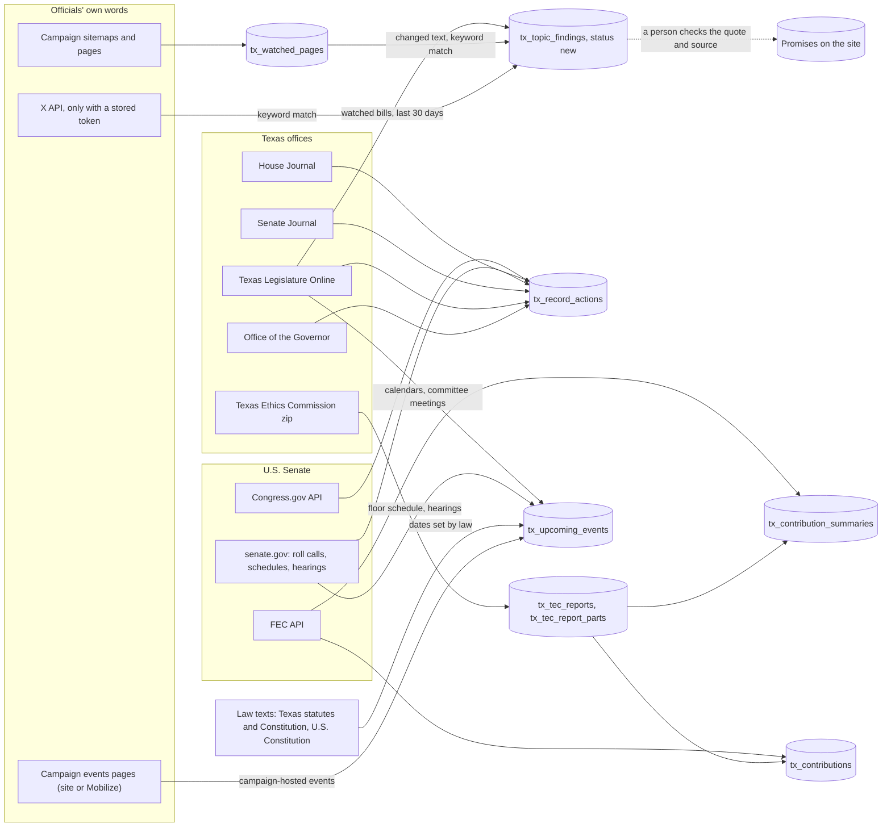

# Sync

How Sync works: every source it reads, how a run starts, and each phase from the claim to the
"Last run results" panel.

The code lives in:

| Piece | File |
| --- | --- |
| The button and the "Last run results" panel | [`components/sync-button.tsx`](components/sync-button.tsx) |
| The calendar-day rule and the run summary | [`lib/sync.ts`](lib/sync.ts) |
| Read-only status for agents (`GET /api/sync`) | [`app/api/sync/route.ts`](app/api/sync/route.ts) |
| The Edge Function: claim, stages, and the run log | [`supabase/functions/tx_sync/index.ts`](supabase/functions/tx_sync/index.ts) |
| The source registry (what runs per office, and what the notes call "not automated") | [`supabase/functions/tx_sync/sources.ts`](supabase/functions/tx_sync/sources.ts) |
| FEC, Congress.gov, Senate roll calls | [`federal.ts`](supabase/functions/tx_sync/federal.ts) |
| House Journal record votes, TLO authored and co-authored bills | [`texas.ts`](supabase/functions/tx_sync/texas.ts), [`journal.ts`](supabase/functions/tx_sync/journal.ts) |
| Governor's signings, vetoes, bills filed without signature, executive orders | [`governor.ts`](supabase/functions/tx_sync/governor.ts) |
| Texas Senate Journal (votes by the presiding officer) | [`senate_journal.ts`](supabase/functions/tx_sync/senate_journal.ts) |
| Texas Ethics Commission campaign finance | [`tec.ts`](supabase/functions/tx_sync/tec.ts), [`tec_zip.ts`](supabase/functions/tx_sync/tec_zip.ts) |
| The topic sweep: watched bills, campaign pages, X posts | [`topics.ts`](supabase/functions/tx_sync/topics.ts) |
| Events: the refresh rule and Central time | [`events.ts`](supabase/functions/tx_sync/events.ts) |
| Events: dates set by law | [`events_law.ts`](supabase/functions/tx_sync/events_law.ts) |
| Events: Texas floor calendars and committee meetings | [`events_texas.ts`](supabase/functions/tx_sync/events_texas.ts) |
| Events: U.S. Senate floor schedule and committee hearings | [`events_senate.ts`](supabase/functions/tx_sync/events_senate.ts) |
| Events: campaign events pages | [`events_campaign.ts`](supabase/functions/tx_sync/events_campaign.ts) |
| The Events page, the event page, and the nerds page's Upcoming tab | [`app/events`](app/events), [`components/events-calendar.tsx`](components/events-calendar.tsx), [`lib/events.ts`](lib/events.ts) |
| Which source fills which events (by `event_key` prefix), and Congress.gov links for hearing bills | [`lib/event-sources.ts`](lib/event-sources.ts) |
| Unit tests on saved primary-source pages | [`tests/sync_test.ts`](supabase/functions/tx_sync/tests/sync_test.ts) |
| Live check of every parser against the real sources (no writes) | [`scripts/sync-live-check.ts`](scripts/sync-live-check.ts) |
| Claim, nightly job, IDs, TEC tables | [`supabase/migrations/20261109150000_tx_sync_gaps.sql`](supabase/migrations/20261109150000_tx_sync_gaps.sql) |
| Event columns, committee memberships, campaign events pages | [`supabase/migrations/20261109200000_tx_events_calendar.sql`](supabase/migrations/20261109200000_tx_events_calendar.sql) |

The button is on `/how-we-track` and on each official's "For nerds" page.

## Keeping this file current

This file is the reference for Sync, so it changes in the same pull request as Sync does (AGENTS.md
rule 21). A pull request that changes any of these updates SYNC.md too:

- `supabase/functions/tx_sync/` (not only `tests/`), `scripts/sync-live-check.ts`, `lib/sync.ts`,
  `components/sync-button.tsx`, `app/api/sync/`.

Check each section against the change: the code table above, the sources table, where each ID comes
from, the rules (including the Events rules), the diagram, the order of stages, the counts written to
`ingest_runs`, the limits, and the testing commands. CI's "SYNC.md updated with Sync changes" job fails
a pull request that changes those files without touching this one. If a change truly does not affect
anything described here (a pure refactor), say so in the pull request description with the line
`SYNC.md: no change needed` and why.

## 1. Sources

Sync reads only primary sources. Every row it writes keeps a `source_url` that points back to the
record it was copied from. Every lookup uses an ID stored for the official, never a last name.

| Source | What Sync requests | Who | Matched on | Writes to |
| --- | --- | --- | --- | --- |
| **FEC API** (`api.open.fec.gov/v1`) | `candidate/{id}/committees?designation=P`, then per cycle `candidate/{id}/totals`, `schedule_a/by_state`, `schedule_a/by_employer`, `schedule_a` (100 largest individual gifts) | `us_senate` | `politicians.fec_candidate_id` | `tx_contribution_summaries`, `tx_contributions` |
| **Congress.gov API** (`api.congress.gov/v3`) | `member/{bioguideId}/sponsored-legislation` and `cosponsored-legislation`, every page (`pagination.next`) | `us_senate` | `politicians.bioguide_id` | `tx_record_actions` (`sponsored`, `cosponsored`) |
| **U.S. Senate roll calls** (`senate.gov/legislative/LIS`) | `vote_menu_{congress}_{session}.xml` for the previous and current session, then each new roll call's XML, 40 per batch | `us_senate`, from `term_start` | `politicians.lis_member_id` | `tx_record_actions` (`vote`) |
| **Texas House Journal** (journal web service + `journals.house.texas.gov`) | `journals-for-legislature/{leg}/H`, then every day page of the term; every record vote on each page | `tx_house`, from `term_start` | `tx_legislative_service.journal_name` for the current legislature | `tx_record_actions` (`vote`, insert only) |
| **Texas Legislature Online** author reports (`capitol.texas.gov/Reports`) | `Report.aspx?ID=author` and `ID=coauthor` for each session of the legislature, then each new bill's `Authors.aspx` for the date | `tx_house`, from `term_start` | `tx_legislative_service.tlo_member_code` | `tx_record_actions` (`sponsored`, `cosponsored`, insert only) |
| **Texas Legislature Online** governor reports | `Report.aspx?ID=signedbygov`, `vetoedbygov`, `filedwogovsign` for each session, then each new bill's `History.aspx` for the date | `governor`, from `term_start` | The office | `tx_record_actions` (`signed`, `vetoed`, `filed_without_signature`, insert only) |
| **Office of the Governor** (`gov.texas.gov/news/archive/YYYY/MM`) | Each month of the term; each new post once. An order is found by its own PDF (`/uploads/files/press/EO-…pdf`) | `governor`, from `term_start` | Order numbers carrying the governor's initials | `tx_record_actions` (`executive_order`, insert only) |
| **Texas Senate Journal** (journal web service + `journals.senate.texas.gov`) | `journals-for-legislature/{leg}/S`, then every day page of the term; every roll call | `tx_lt_governor`, from `term_start` | "Mr. President" or "Madam President" in a Yeas or Nays list | `tx_record_actions` (`vote`, insert only) |
| **Texas Ethics Commission** (`TEC_CF_CSV.zip`, by byte range) | `cover.csv` (report totals), then the `contribs_NN.csv` files that hold the official's reports | `governor`, `tx_lt_governor`, `tx_house` | `politicians.tec_filer_id` | `tx_tec_reports`, `tx_tec_report_parts`, then `tx_contribution_summaries`, `tx_contributions` |
| **Texas Legislature Online** bill history | `History.aspx` for each bill in an active topic's `related_bills` | Every active topic | Bill number | `tx_topic_findings` (`bill_action`, last 30 days), and House votes as above |
| **Campaign sites** | `{origin}/sitemap.xml` (two levels, up to 600 URLs) plus `politicians.campaign_watch_urls`, then every page in batches of 100 | Every official with a campaign site | URL | `tx_watched_pages`, `tx_topic_findings` (`page`) |
| **X API** (`api.x.com/2`) | `users/{x_user_id}/tweets` (100 posts, no retweets) | Officials with `x_user_id` | `x_user_id` | `tx_topic_findings` (`post`) |
| **Dates set by law** (`tcss.legis.texas.gov/resources`, the file server behind statutes.capitol.texas.gov; senate.gov's Constitution page) | `GV/htm/GV.301.htm`, `CN/htm/CN.3.htm`, `CN/htm/CN.4.htm`; the 20th Amendment | Every office, for the regular session that is upcoming | The office | `tx_upcoming_events` (`session_day`, `deadline`) |
| **Texas Legislature Online** calendars (`MyTLO/RSS/RSS.aspx`), the lists behind TLO's House Calendars page (`Calendars/CalendarsHouse.aspx`) and Senate Calendars page | `Type=upcomingcalendarshouse` or `upcomingcalendarssenate` | `tx_house` (House), `tx_lt_governor` (Senate), from `term_start` | The chamber | `tx_upcoming_events` (`floor_vote`) |
| **Texas Legislature Online** committee meetings | `Members/MemberInfo.aspx` for the member's committees, then `Type=upcomingmeetingshouse` and `upcomingmeetingsjoint` | `tx_house`, from `term_start` | `tx_legislative_service.tlo_member_code`, then committee code | `tx_committee_memberships`, `tx_upcoming_events` (`committee_hearing`) |
| **U.S. Senate** schedules (senate.gov) | `legislative/schedule/floor_schedule.htm` (next meeting) and `legislative/{year}_schedule.xml` (tentative schedule) | `us_senate`, from `term_start` | The office | `tx_upcoming_events` (`session_day`) |
| **U.S. Senate** committee hearings | `legislative/LIS_MEMBER/cvc_member_data.xml` for the senator's committees, then `general/committee_schedules/hearings.xml` | `us_senate`, from `term_start` | `politicians.bioguide_id`, then committee code | `tx_committee_memberships`, `tx_upcoming_events` (`committee_hearing`) |
| **Campaign events pages** | `politicians.campaign_events_url`: a Squarespace page read as `?format=json`, or a Mobilize page (`mobilize.us/{org}`) read through `api.mobilize.us/v1/organizations/{id}/events` | Every official, from `term_start` | The page linked from the campaign's own site | `tx_upcoming_events` (`appearance`, `is_campaign`) |

X runs only when `tx_private_settings.x_bearer_token` is stored. Without it, each run notes that X
posts were not checked. X is never scraped.

### Where each ID comes from

| ID | Where to find it | When it exists |
| --- | --- | --- |
| `fec_candidate_id` | fec.gov candidate page | From the first filing (Talarico: `S6TX00479`) |
| `bioguide_id` | congress.gov member page | When Congress.gov lists the member, after the swearing-in |
| `lis_member_id` | `<lis_member_id>` in any senate.gov roll-call XML | After the first roll call |
| `tec_filer_id` | TEC filer search (`filers.csv` in the TEC zip) | From the campaign treasurer appointment |
| `tlo_member_code` | `capitol.texas.gov/Reports/BillsBy.aspx` author list (for example `Goodwin (H-A3820)`) | When the member is listed for the session; the code stays the same across sessions |
| `journal_name` | The name the House Journal prints for the member that legislature | One `tx_legislative_service` row per legislature, sourced from the Legislative Reference Library |
| `campaign_events_url` | The events page the campaign site's own menu links to (vikkigoodwin.com/events; the Mobilize pages linked from ginafortexas.com, jamestalarico.com and zach4texas.com) | Set in the events migration, checked 2026-11-09 |
| Committee membership | The member's TLO page (`MemberInfo.aspx`) or senate.gov's member data, read by Sync into `tx_committee_memberships` | When the committees are appointed for the session (early in 2027) |

When an ID is missing, the source writes a note that names the column and where to find it. It
never falls back to a name search.

### Rules for each source

- **FEC cycles.** Sync loads the cycle of the election the official won, plus every cycle after it
  up to the one that holds today. The 2026 winner loads 2026 through the end of 2026, then 2026
  and 2028 in 2027-2028, and so on. Fundraising for the next election shows up as soon as its
  cycle starts. The page shows the latest cycle. TEC uses the same rule.
- **Congress.gov rows are refreshed on every run.** They are upserted on `external_id`, so `title`
  and `result` (the latest action, for example "Became Public Law No: 120-3. (2027-05-01)") follow
  the bill until it is enacted or dies. `promise_id` and `what_it_does` are never sent, so a link
  to a promise and any hand-written explanation are kept. A bill without an introduced date is
  skipped and noted, never dated "today".
- **Every other record is insert-only.** House and Senate Journal votes, TLO authored bills, and the
  governor's actions are written with `ignoreDuplicates`, so a row checked or corrected by hand is
  never overwritten. Events are the other exception: they are refreshed (see Events below).
- **Senate sessions at the turn of the year.** Sync reads the previous session first, then the new
  one, 40 roll calls per batch, until both are done.
- **Executive orders.** Texas governors number their orders with their initials (GA-57 is Greg
  Abbott's). A post that links an order with another prefix (an earlier governor's) is noted and
  not stored. An order announced in several posts takes the date of the first one.
- **Campaign pages.** A match of fewer than five words (a menu item, a button, a heading) is not
  queued, and a passage is queued once per official and topic, not once for every page it appears
  on. Without this, reading every page queued a site's "Cannabis & THC" menu label 233 times.
- **Senate Journal.** The lieutenant governor is not a senator, so the journal lists them in a
  roll call only when they vote (a tie, or the Committee of the Whole). That is rare: none from
  1999 to 2025. Every day of the term is still read once.
- **TEC.** Reports a later report replaced (`infoOnlyFlag = Y`) are left out. A contribs file is
  read again only when its CRC changes, and only files that hold the official's reports are read.
  Files run in the order reports arrived, so a report is looked for by the day it was received
  (report IDs are not in file order). The TEC's CDN refuses byte ranges (403) after a burst of
  requests, so Sync reads the zip's directory once per run (kept in `tx_tec_files`) and makes at
  most 15 requests per run, 4 seconds apart. The first backfill therefore takes a few daily runs;
  after that a day needs only a handful of requests.
- **TEC, long files.** A stage call has 2 seconds of CPU, and parsing every matching row of a busy
  file takes more: `contribs_112.csv` (57 MB, the 8-day reports filed from 2026-10-26; Hinojosa's
  alone is 229,722 rows) ran out of CPU in every stage on 2026-11-12. So rows of other filers, rows that are not
  receipts (`recordType` other than `RCPT`) and rows of replaced reports are dropped by their first
  seven fields before a row is parsed, and one call parses at most 50,000 kept rows. A file with
  more goes on in the next call, which requests the file again, skips the rows already counted,
  and adds to the totals carried from the call before. The file's parts are written, and its CRC
  marked read, only when its last rows are in. Each of those extra requests counts toward the 15.
  If the run ends partway through a file, the next run reads that file again from its first row.

### Events

Five sources fill `tx_upcoming_events`, one per kind of event, each in the registry. All of them were
checked with real requests on 2026-11-09 before the parsers were written:

- **TLO's RSS feeds** list every upcoming calendar and every posted committee meeting with a link to the
  document itself. A meeting's link carries its committee code, date and time
  (`tlodocs/88R/schedules/html/C4102023032708001.htm` is committee C410 on 2023-03-27 at 8:00). Between
  sessions the feeds say "No committee meetings scheduled." and "No calendars are available.", as they
  did on 2026-11-09; the tests use copies the Internet Archive saved during the 88th Legislature.
  - **The House calendar.** TLO's House Calendars page (`Calendars/CalendarsHouse.aspx`) explains the
    calendar types and links "Calendars for upcoming dates" (`CalendarsByLegislature.aspx?Chbr=H`).
    That list is the `upcomingcalendarshouse` feed: the feed's own `<link>` is that page. Sync reads the
    feed, not the HTML; each event cites its own calendar document (`tlodocs/{session}/calendars/html/…`),
    and the Events page links the House Calendars page while none is loaded.
  - **"Nothing posted" is no event.** On 2026-11-10 all five feeds (`upcomingcalendarshouse`,
    `upcomingcalendarssenate`, `upcomingmeetingshouse`, `upcomingmeetingssenate`,
    `upcomingmeetingsjoint`) again held one item each, titled as above, with no `<link>` and the HTML
    list page as its `<guid>`. `checkFeed` in `events_texas.ts` recognizes exactly that item and never
    turns it into an event. A response that is not an RSS channel throws, so an error page is never read
    as an empty feed.
  - **Format not yet confirmed on the live site.** The parsers follow the populated 2023 copies. Every
    item that is neither the "nothing posted" item nor in that format is counted and named in the run
    notes and not loaded, and that feed is then not treated as the whole list (no "no longer listed"
    notes). While `LIVE_POPULATED_FEED_SAVED` is null, the "nothing posted" note also says the live
    format is unconfirmed. When the first populated feed appears (interim hearings, or the session's
    calendars from January), save it as a fixture, run the tests on it, and set that constant to the
    date.
  - `upcomingmeetingssenate` is read by the live check only: no tracked official sits on a Texas Senate
    committee (the lieutenant governor presides but is not a member).
- **senate.gov** publishes the next meeting (`floor_schedule.htm`, "Convene at 3:00 p.m."), a tentative
  schedule of non-legislative periods per year (`2026_schedule.xml`; 2027's is not published yet), every
  scheduled committee hearing (`hearings.xml`), and each senator's committees by bioguide ID
  (`cvc_member_data.xml`).
- **The law's own text.** statutes.capitol.texas.gov is a JavaScript app; its texts are served as plain
  HTML from `tcss.legis.texas.gov/resources/{code}/htm/{chapter}.htm`. The Texas Legislative Council's
  "Dates of Interest" sheet lists the same convening day (2027-01-12, noon).
- **Campaign events pages.** Goodwin's site is Squarespace (`/events?format=json` has `upcoming` and
  `past`). The other three campaigns link a Mobilize page; Mobilize's public API lists its events. On
  2026-11-09 every upcoming event on those pages was hosted by a party organization, not the campaign.

Rules:

- **Refresh, unlike votes.** Events are upserted on `external_id`. A row is written only when it is new
  or when its kind, title, date, end date, time, place, details, body, bills, source link or status
  changed; then `status` becomes `changed` (or `cancelled`, below) and `updated_at` is set. A row that
  did not change is not written. Nothing is deleted, and past events stay stored. Stored rows are
  looked up by the `external_id`s being written, whatever their date, so a date already past that a
  source still lists (the convening day while that session is in progress) is compared, not added
  again each run.
- **Cancelled only when the source says so** ("cancel" in a TLO item, or a Senate hearing typed or
  described as cancelled or postponed). An event that drops off a source that lists everything
  upcoming (the TLO calendar and meeting feeds, senate.gov's hearing schedule, a campaign events page)
  before its date is named in the run notes and left as it is. Dates set by law, the Senate's next
  meeting and its tentative schedule are not checked for drop-offs. `held` is in the schema but Sync
  never sets it.
- **One row per official per event.** `event_key` is shared by every official's row of the same event
  (`law:90R:convene` for the representative and the lieutenant governor); `external_id` is
  `{event_key}:{slug}`.
- **Who gets what.** The representative: Texas House calendars, hearings of their committees (House and
  joint), the session's dates. The lieutenant governor: Texas Senate calendars, the session's dates, the
  term start. The governor: the installation and the veto period. The senator: the Senate's next
  meeting, the tentative schedule's non-legislative periods (stored as session-day events titled "No
  Senate session expected"), hearings of their committees, the term start. Everyone: their campaign's
  events.
- **Which session.** Dates set by law are computed for one regular session: the one in progress, or
  the next one. A session stays current until its veto period ends (20 days after its 140th day).
- **Before the term starts**, only events that concern the office are stored: the convening of a session
  the official will sit in, and the day the term begins. Floor calendars, hearings, Senate meetings and
  campaign events are stored from `term_start` on.
- **Dates set by law** are computed only as the law states them, from the sentence each rule depends
  on. If that sentence is not found word for word in the current text, the dates that depend on it are
  not loaded and the run says why. Each row carries `legal_basis`, `legal_url` and `computed_from`:
  - Convening: noon on the second Tuesday in January of an odd year (Tex. Gov't Code §301.001).
  - 60th day: the end of the two 30-day periods for introducing and hearing bills (Tex. Const. art. 3,
    §5(b)), counting the convening day as day 1. The 89th Legislature (2025-01-14, 2025-03-14) checks it.
  - 140th day: the longest a regular session may run (art. 3, §24(b)).
  - The governor's veto period: 20 days after adjournment (art. 4, §14), counted from the 140th day; the
    event page says it ends earlier if the Legislature adjourns earlier.
  - Installation: the first Tuesday after the Legislature organizes (art. 4, §4); the lieutenant
    governor serves the same term (art. 4, §16(a)). Senate terms begin at noon on January 3 (U.S. Const.
    amend. XX, §1).
- **Times.** A time is stored only when the source gives one. TLO times are Central; Senate times are
  Eastern and converted, with the Senate's own wording kept in `details`. A TLO time like "2:30 PM or
  upon final adjourn." is stored as 2:30 PM with the full wording in `details`.
- **Campaign events** keep only events the campaign's own organization hosts, labeled as campaign events
  (`is_campaign`), with the date, time, place and title as the page states them.
- **Bills a Senate hearing names** are kept for every type senate.gov lists (S, HR, SJRES, HJRES, SRES,
  HRES, SCONRES, HCONRES; nominations are not bills). The event page links each to Congress.gov for
  the Congress in session on the hearing's date ("121st-congress"), and shows any other as text.
- **"Not loaded yet."** Each source owns the `event_key`s it writes (`law:`, `tlo_calendar:{session}:H:`
  for the House, `tlo_calendar:{session}:S:` for the Senate, `tlo_hearing:`, `senate_floor:`,
  `senate_schedule:`, `senate_hearing:`, `campaign:`). The Events page and the Upcoming tab call a source
  loaded only when one of its own events is, so one source's events never hide another that has none
  (House calendars never make the Senate's look loaded). The Events page links each unloaded source
  to the page that lists it when there is one (the House calendars to `Calendars/CalendarsHouse.aspx`).
  A new event source adds its pattern and page to `lib/event-sources.ts`.
- **Committee membership** is stored, never guessed: a hearing is matched only by committee code (and,
  for TLO, the same legislature, so a committee carries over into its called sessions). Until the
  representative's `tlo_member_code` for the 90th Legislature and the senator's `bioguide_id` are
  stored, the run notes say so and no hearings are loaded.
- **Run notes.** Every run notes, per official, what each events page listed and how many of its
  events were kept; what each TLO feed said when nothing is posted, and any feed item in a format the
  parser does not read; when no floor calendars are posted yet; a missing ID or committee list; a law text
  that no longer reads as expected; and a tentative Senate schedule that is not published yet.

### Not automated yet

The notes come from the registry in `sources.ts`: a source with `run: null` is listed in each run's
notes for every official it applies to. Every source in the registry now has a run, so no office
gets a "not automated" note. To add a source that is not built yet, add it with `run: null`, and the
notes will name it until it ships.

### Sources and where their data lands



The dotted line is manual. A finding is never published as a promise by Sync.

## 2. How a run starts

One run per **calendar day in Central time** for the whole site.

- **The button.** Anyone can press "Sync all officials". If no run has started since midnight CT,
  a run starts. Otherwise the function replies 429 with the time until midnight CT.
- **The nightly job.** pg_cron calls `tx_tracker.tx_nightly_sync()` at 04:30 and 05:30 UTC. It acts
  only when it is 11 pm in Central time (04:30 UTC in daylight time, 05:30 UTC in standard time),
  and starts a run only if none started that day. It posts `{"trigger":"schedule"}` to the
  function address stored in `tx_private_settings.sync_function_url`.
- `ingest_runs.triggered_by` records `button` or `schedule`, and the panel says "started by the
  nightly schedule" for scheduled runs.

So a run happens every day, and the site always shows a sync from today or yesterday.

## 3. Phases

```mermaid
sequenceDiagram
  autonumber
  actor V as Visitor or pg_cron
  participant F as tx_sync (public request)
  participant DB as Postgres (tx_tracker)
  participant S as tx_sync (stage requests)
  participant X as Sources

  V->>F: POST (body {"trigger":"schedule"} from the nightly job)
  F->>DB: rpc tx_claim_sync(p_trigger)
  alt A run already started today (CT)
    DB-->>F: run_id = null, next_allowed_at = midnight CT
    F-->>V: 429, Retry-After
  else Day is free
    DB->>DB: Insert ingest_runs (triggered_by)
    F-->>V: 202 "Sync started"
    loop Each source for each official, then each topic step
      F->>S: POST with x-tx-stage (key from tx_private_settings.sync_stage_key)
      S->>X: Read the source
      S->>DB: Write rows
      S-->>F: { log, more }
      Note over F,S: "more" means the source has a backlog; it is called again while time is left
    end
    F->>DB: Update ingest_runs: finished_at, counts, errors, notes
  end
```

### Why stages

An Edge Function gets **2 seconds of CPU per request** and 400 seconds of wall clock on the paid
plan. Reading a 197 MB TEC file or a long journal day takes real CPU, so each source for each
official runs in its own request with its own CPU budget. The background task only waits on those
requests. A stage that fails, times out, or hits the CPU limit is written to the run's errors as
`{ source: "<key>:<slug>", message }`, and the next stage still runs.

A stage call can hand a carry to the calls after it in the same run: its reply holds `carry`, and the
background task sends it with every later stage request. TEC uses it to go on reading a long file
where the last call stopped. A failed call leaves the carry as it was. The carry is never saved, so
it lasts one run.

Stage requests carry `x-tx-stage` with a key generated in the database
(`tx_private_settings.sync_stage_key`), which only the function can read. A request without the
right key is refused with 403. The public request never runs a stage itself.

### Order of stages

1. For each official, each source the registry lists for their office (`sourcesFor(office)`), in
   registry order: records and money first, then the event sources (`events_law`,
   `events_tx_floor`, `events_tx_hearings`, `events_senate_floor`, `events_senate_hearings`,
   `events_campaign`).
2. `topics_bills`: watched bills on Texas Legislature Online, with House record votes for every
   official who served in that legislature.
3. `topics_sitemaps`: list campaign pages.
4. `topics_pages`: read pages in batches of 100, repeated until every page has been read this run.
5. `topics_x`: X posts, if a token is stored.

A source with a backlog (journal days, roll calls, TEC files, pages) returns `more`, and the run
calls it again, up to 20 times, while the run's 370-second budget lasts. Anything left continues
the next day, oldest first.

### Close the run log

In a `finally` block, so it runs even after errors:

| Column | Holds |
| --- | --- |
| `finished_at` | When the run ended |
| `triggered_by` | `button` or `schedule` |
| `counts` | `fec_summaries`, `fec_contributions`, `congress_sponsored`, `congress_cosponsored`, `senate_votes`, `house_votes`, `house_journal_days`, `tlo_bills`, `governor_actions`, `executive_orders`, `senate_journal_votes`, `senate_journal_days`, `tec_reports`, `tec_files_read`, `tec_batches_read`, `tec_summaries`, `tec_contributions`, `topic_bills_checked`, `topic_pages_checked`, `topic_pages_changed`, `topic_posts_checked`, `topic_matches`, `events_added`, `events_changed` |
| `errors` | `{ source, message }` for each source that failed |
| `notes` | One line per skipped source, missing ID, or backlog |

### What visitors see

"Last run results" (`syncSummary` in `lib/sync.ts`) shows when the run finished and whether the
nightly schedule started it, pages and bills checked, **each failed source with its message**, and
**every run note**, plus per official and per topic how many matches the last run found and how
many findings wait for review. It is checked in both light and dark mode.

The Events page (`/events`) and each official's Upcoming tab read `tx_upcoming_events` through the
ledger, which is cached for minutes, so new events show up a minute or two after a run writes them.
The Events page's footer shows the last Sync time.

## Limits

| Limit | Value | Where |
| --- | --- | --- |
| Runs | One per calendar day (CT) for the whole site | `tx_claim_sync` |
| Nightly fill-in | 11:30 pm CT | `cron.job` `tx_nightly_sync` |
| Run budget | 370 seconds | `RUN_BUDGET_MS` |
| One stage request | 120 seconds | `STAGE_BUDGET_MS` |
| Repeats of a stage with a backlog | 20 per run | `MAX_REPEATS` |
| Senate roll calls per batch | 40 | `MAX_VOTES_PER_SYNC` |
| House Journal days per batch | 25 | `MAX_JOURNAL_DAYS_PER_RUN` |
| Senate Journal days per batch | 30 | `MAX_SENATE_DAYS_PER_CALL` |
| New TLO bills per batch | 60 | `MAX_NEW_BILLS_PER_RUN` |
| Bill histories per governor batch | 80 | `MAX_HISTORIES_PER_CALL` |
| Governor posts per batch | 80 | `MAX_POSTS_PER_CALL` |
| Requests to the TEC | 15 per run, 4 seconds apart | `MAX_TEC_REQUESTS_PER_RUN`, `TEC_REQUEST_GAP_MS` |
| TEC contribution rows parsed per call | 50,000 | `TEC_ROWS_PER_CALL` |
| Campaign pages per batch | 100, 6 at a time | `PAGE_BATCH`, `PAGE_CONCURRENCY` |
| URLs taken from one sitemap | 600 | `MAX_SITEMAP_URLS` |
| Excerpts per page and topic | 10 | `MAX_FINDINGS_PER_PAGE_TOPIC` |
| Bill actions queued | Last 30 days | `BILL_ACTION_WINDOW_DAYS` |
| Requests per events stage, one at a time | Law texts: 1 (senator) to 3 (each distinct law page once). TLO calendars: 1. TLO hearings: the member page plus 2 feeds. Senate floor: the floor schedule plus 2 schedule years. Senate hearings: member data plus hearings. Campaign events: 1 (Squarespace) or 2 (Mobilize page plus API) | `events_*.ts` |

All requests send the user agent
`PromiseVsDelivered/1.0 (+https://github.com/stozo04/tx-promise-tracker)`.

## Testing

```bash
deno test --allow-read --node-modules-dir=none supabase/functions/tx_sync/tests/
```

```bash
deno run --allow-net --allow-env=DATA_GOV_KEY --node-modules-dir=none scripts/sync-live-check.ts
```

The tests run on real pages saved from each source (`tests/fixtures`): 54 tests, of which G1 to G10
cover the event sources, the refresh rule, "Not loaded yet", and hearing bill links. G2 also covers
every TLO feed as the live site served it between sessions (2026-11-09 and 2026-11-10), an item in an
unknown format, and a Sync run on an empty House calendars feed. B1 also checks that a TEC file
read in batches, with the carry passed as JSON between calls, adds up to the same parts as one read,
that matching lines come in file order whatever the chunking, and that rows of other filers and of replaced reports are dropped before they are parsed. CI runs them on every pull request. Strip any keys a
saved page embeds before committing it (a Mobilize page carries Mapbox, Google, Algolia and Facebook
browser keys; GitHub push protection blocks them). The live check reads the real sources and prints statistics; it writes nothing. Its `events`
section (`scripts/sync-live-check.ts events`) prints, for each event source, how many items it parsed
against how many the page lists, and a sample. For TLO's feeds it also prints the "nothing posted" item
and how many items the parser could not read; a nonzero "not read" means the live format changed.
