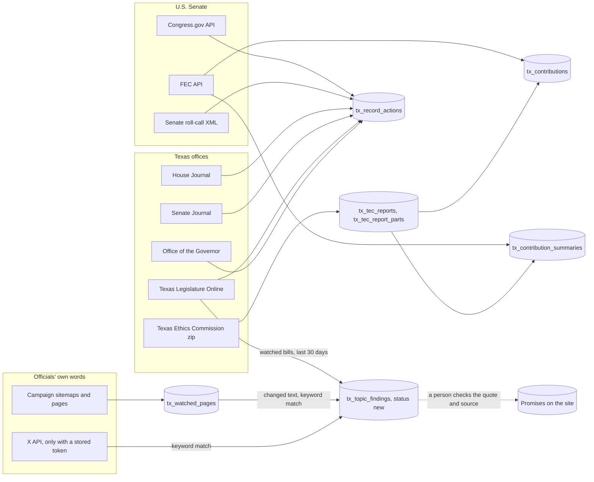

# Sync

How Sync works: every source it reads, how a run starts, and each phase from the claim to the
"Last run results" panel.

The code lives in:

| Piece | File |
| --- | --- |
| The button and the "Last run results" panel | [`components/sync-button.tsx`](components/sync-button.tsx) |
| The calendar-day rule and the run summary | [`lib/sync.ts`](lib/sync.ts) |
| Read-only status for agents (`GET /api/sync`) | [`app/api/sync/route.ts`](app/api/sync/route.ts) |
| The Edge Function: claim, stages, and the run log | [`supabase/functions/tx_sync/index.ts`](supabase/functions/tx_sync/index.ts) |
| The source registry (what runs per office, and what the notes call "not automated") | [`supabase/functions/tx_sync/sources.ts`](supabase/functions/tx_sync/sources.ts) |
| FEC, Congress.gov, Senate roll calls | [`federal.ts`](supabase/functions/tx_sync/federal.ts) |
| House Journal record votes, TLO authored and co-authored bills | [`texas.ts`](supabase/functions/tx_sync/texas.ts), [`journal.ts`](supabase/functions/tx_sync/journal.ts) |
| Governor's signings, vetoes, bills filed without signature, executive orders | [`governor.ts`](supabase/functions/tx_sync/governor.ts) |
| Texas Senate Journal (votes by the presiding officer) | [`senate_journal.ts`](supabase/functions/tx_sync/senate_journal.ts) |
| Texas Ethics Commission campaign finance | [`tec.ts`](supabase/functions/tx_sync/tec.ts), [`tec_zip.ts`](supabase/functions/tx_sync/tec_zip.ts) |
| The topic sweep: watched bills, campaign pages, X posts | [`topics.ts`](supabase/functions/tx_sync/topics.ts) |
| Unit tests on saved primary-source pages | [`tests/sync_test.ts`](supabase/functions/tx_sync/tests/sync_test.ts) |
| Live check of every parser against the real sources (no writes) | [`scripts/sync-live-check.ts`](scripts/sync-live-check.ts) |
| Claim, nightly job, IDs, TEC tables | [`supabase/migrations/20261109150000_tx_sync_gaps.sql`](supabase/migrations/20261109150000_tx_sync_gaps.sql) |

The button is on `/how-we-track` and on each official's "For nerds" page.

## 1. Sources

Sync reads only primary sources. Every row it writes keeps a `source_url` that points back to the
record it was copied from. Every lookup uses an ID stored for the official, never a last name.

| Source | What Sync requests | Who | Matched on | Writes to |
| --- | --- | --- | --- | --- |
| **FEC API** (`api.open.fec.gov/v1`) | `candidate/{id}/committees?designation=P`, then per cycle `candidate/{id}/totals`, `schedule_a/by_state`, `schedule_a/by_employer`, `schedule_a` (100 largest individual gifts) | `us_senate` | `politicians.fec_candidate_id` | `tx_contribution_summaries`, `tx_contributions` |
| **Congress.gov API** (`api.congress.gov/v3`) | `member/{bioguideId}/sponsored-legislation` and `cosponsored-legislation`, every page (`pagination.next`) | `us_senate` | `politicians.bioguide_id` | `tx_record_actions` (`sponsored`, `cosponsored`) |
| **U.S. Senate roll calls** (`senate.gov/legislative/LIS`) | `vote_menu_{congress}_{session}.xml` for the previous and current session, then each new roll call's XML, 40 per batch | `us_senate`, from `term_start` | `politicians.lis_member_id` | `tx_record_actions` (`vote`) |
| **Texas House Journal** (journal web service + `journals.house.texas.gov`) | `journals-for-legislature/{leg}/H`, then every day page of the term; every record vote on each page | `tx_house`, from `term_start` | `tx_legislative_service.journal_name` for the current legislature | `tx_record_actions` (`vote`, insert only) |
| **Texas Legislature Online** author reports (`capitol.texas.gov/Reports`) | `Report.aspx?ID=author` and `ID=coauthor` for each session of the legislature, then each new bill's `Authors.aspx` for the date | `tx_house`, from `term_start` | `tx_legislative_service.tlo_member_code` | `tx_record_actions` (`sponsored`, `cosponsored`, insert only) |
| **Texas Legislature Online** governor reports | `Report.aspx?ID=signedbygov`, `vetoedbygov`, `filedwogovsign` for each session, then each new bill's `History.aspx` for the date | `governor`, from `term_start` | The office | `tx_record_actions` (`signed`, `vetoed`, `filed_without_signature`, insert only) |
| **Office of the Governor** (`gov.texas.gov/news/archive/YYYY/MM`) | Each month of the term; each new post once. An order is found by its own PDF (`/uploads/files/press/EO-…pdf`) | `governor`, from `term_start` | Order numbers carrying the governor's initials | `tx_record_actions` (`executive_order`, insert only) |
| **Texas Senate Journal** (journal web service + `journals.senate.texas.gov`) | `journals-for-legislature/{leg}/S`, then every day page of the term; every roll call | `tx_lt_governor`, from `term_start` | "Mr. President" or "Madam President" in a Yeas or Nays list | `tx_record_actions` (`vote`, insert only) |
| **Texas Ethics Commission** (`TEC_CF_CSV.zip`, by byte range) | `cover.csv` (report totals), then the `contribs_NN.csv` files that hold the official's reports | `governor`, `tx_lt_governor`, `tx_house` | `politicians.tec_filer_id` | `tx_tec_reports`, `tx_tec_report_parts`, then `tx_contribution_summaries`, `tx_contributions` |
| **Texas Legislature Online** bill history | `History.aspx` for each bill in an active topic's `related_bills` | Every active topic | Bill number | `tx_topic_findings` (`bill_action`, last 30 days), and House votes as above |
| **Campaign sites** | `{origin}/sitemap.xml` (two levels, up to 600 URLs) plus `politicians.campaign_watch_urls`, then every page in batches of 100 | Every official with a campaign site | URL | `tx_watched_pages`, `tx_topic_findings` (`page`) |
| **X API** (`api.x.com/2`) | `users/{x_user_id}/tweets` (100 posts, no retweets) | Officials with `x_user_id` | `x_user_id` | `tx_topic_findings` (`post`) |

X runs only when `tx_private_settings.x_bearer_token` is stored. Without it, each run notes that X
posts were not checked. X is never scraped.

### Where each ID comes from

| ID | Where to find it | When it exists |
| --- | --- | --- |
| `fec_candidate_id` | fec.gov candidate page | From the first filing (Talarico: `S6TX00479`) |
| `bioguide_id` | congress.gov member page | When Congress.gov lists the member, after the swearing-in |
| `lis_member_id` | `<lis_member_id>` in any senate.gov roll-call XML | After the first roll call |
| `tec_filer_id` | TEC filer search (`filers.csv` in the TEC zip) | From the campaign treasurer appointment |
| `tlo_member_code` | `capitol.texas.gov/Reports/BillsBy.aspx` author list (for example `Goodwin (H-A3820)`) | When the member is listed for the session; the code stays the same across sessions |
| `journal_name` | The name the House Journal prints for the member that legislature | One `tx_legislative_service` row per legislature, sourced from the Legislative Reference Library |

When an ID is missing, the source writes a note that names the column and where to find it. It
never falls back to a name search.

### Rules for each source

- **FEC cycles.** Sync loads the cycle of the election the official won, plus every cycle after it
  up to the one that holds today. The 2026 winner loads 2026 through the end of 2026, then 2026
  and 2028 in 2027-2028, and so on. Fundraising for the next election shows up as soon as its
  cycle starts. The page shows the latest cycle. TEC uses the same rule.
- **Congress.gov rows are refreshed on every run.** They are upserted on `external_id`, so `title`
  and `result` (the latest action, for example "Became Public Law No: 120-3. (2027-05-01)") follow
  the bill until it is enacted or dies. `promise_id` and `what_it_does` are never sent, so a link
  to a promise and any hand-written explanation are kept. A bill without an introduced date is
  skipped and noted, never dated "today".
- **Everything else is insert-only.** House and Senate Journal votes, TLO authored bills, and the
  governor's actions are written with `ignoreDuplicates`, so a row checked or corrected by hand is
  never overwritten.
- **Senate sessions at the turn of the year.** Sync reads the previous session first, then the new
  one, 40 roll calls per batch, until both are done.
- **Executive orders.** Texas governors number their orders with their initials (GA-57 is Greg
  Abbott's). A post that links an order with another prefix (an earlier governor's) is noted and
  not stored. An order announced in several posts takes the date of the first one.
- **Campaign pages.** A match of fewer than five words (a menu item, a button, a heading) is not
  queued, and a passage is queued once per official and topic, not once for every page it appears
  on. Without this, reading every page queued a site's "Cannabis & THC" menu label 233 times.
- **Senate Journal.** The lieutenant governor is not a senator, so the journal lists them in a
  roll call only when they vote (a tie, or the Committee of the Whole). That is rare: none from
  1999 to 2025. Every day of the term is still read once.
- **TEC.** Reports a later report replaced (`infoOnlyFlag = Y`) are left out. A contribs file is
  read again only when its CRC changes, and only files that hold the official's reports are read.
  Files run in the order reports arrived, so a report is looked for by the day it was received
  (report IDs are not in file order). The TEC's CDN refuses byte ranges (403) after a burst of
  requests, so Sync reads the zip's directory once per run (kept in `tx_tec_files`), reads each
  file with one request, and makes at most 15 requests per run, 4 seconds apart. The first
  backfill therefore takes a few daily runs; after that a day needs only a handful of requests.

### Not automated yet

The notes come from the registry in `sources.ts`: a source with `run: null` is listed in each run's
notes for every official it applies to. Every source in the registry now has a run, so no office
gets a "not automated" note. To add a source that is not built yet, add it with `run: null`, and the
notes will name it until it ships.

### Sources and where their data lands



The dotted line is manual. A finding is never published as a promise by Sync.

## 2. How a run starts

One run per **calendar day in Central time** for the whole site.

- **The button.** Anyone can press "Sync all officials". If no run has started since midnight CT,
  a run starts. Otherwise the function replies 429 with the time until midnight CT.
- **The nightly job.** pg_cron calls `tx_tracker.tx_nightly_sync()` at 04:30 and 05:30 UTC. It acts
  only when it is 11 pm in Central time (04:30 UTC in daylight time, 05:30 UTC in standard time),
  and starts a run only if none started that day. It posts `{"trigger":"schedule"}` to the
  function address stored in `tx_private_settings.sync_function_url`.
- `ingest_runs.triggered_by` records `button` or `schedule`, and the panel says "started by the
  nightly schedule" for scheduled runs.

So a run happens every day, and the site always shows a sync from today or yesterday.

## 3. Phases

```mermaid
sequenceDiagram
  autonumber
  actor V as Visitor or pg_cron
  participant F as tx_sync (public request)
  participant DB as Postgres (tx_tracker)
  participant S as tx_sync (stage requests)
  participant X as Sources

  V->>F: POST (body {"trigger":"schedule"} from the nightly job)
  F->>DB: rpc tx_claim_sync(p_trigger)
  alt A run already started today (CT)
    DB-->>F: run_id = null, next_allowed_at = midnight CT
    F-->>V: 429, Retry-After
  else Day is free
    DB->>DB: Insert ingest_runs (triggered_by)
    F-->>V: 202 "Sync started"
    loop Each source for each official, then each topic step
      F->>S: POST with x-tx-stage (key from tx_private_settings.sync_stage_key)
      S->>X: Read the source
      S->>DB: Write rows
      S-->>F: { log, more }
      Note over F,S: "more" means the source has a backlog; it is called again while time is left
    end
    F->>DB: Update ingest_runs: finished_at, counts, errors, notes
  end
```

### Why stages

An Edge Function gets **2 seconds of CPU per request** and 400 seconds of wall clock on the paid
plan. Reading a 197 MB TEC file or a long journal day takes real CPU, so each source for each
official runs in its own request with its own CPU budget. The background task only waits on those
requests. A stage that fails, times out, or hits the CPU limit is written to the run's errors as
`{ source: "<key>:<slug>", message }`, and the next stage still runs.

Stage requests carry `x-tx-stage` with a key generated in the database
(`tx_private_settings.sync_stage_key`), which only the function can read. A request without the
right key is refused with 403. The public request never runs a stage itself.

### Order of stages

1. For each official, each source the registry lists for their office (`sourcesFor(office)`).
2. `topics_bills`: watched bills on Texas Legislature Online, with House record votes for every
   official who served in that legislature.
3. `topics_sitemaps`: list campaign pages.
4. `topics_pages`: read pages in batches of 100, repeated until every page has been read this run.
5. `topics_x`: X posts, if a token is stored.

A source with a backlog (journal days, roll calls, TEC files, pages) returns `more`, and the run
calls it again, up to 20 times, while the run's 370-second budget lasts. Anything left continues
the next day, oldest first.

### Close the run log

In a `finally` block, so it runs even after errors:

| Column | Holds |
| --- | --- |
| `finished_at` | When the run ended |
| `triggered_by` | `button` or `schedule` |
| `counts` | `fec_summaries`, `fec_contributions`, `congress_sponsored`, `congress_cosponsored`, `senate_votes`, `house_votes`, `house_journal_days`, `tlo_bills`, `governor_actions`, `executive_orders`, `senate_journal_votes`, `senate_journal_days`, `tec_reports`, `tec_files_read`, `tec_summaries`, `tec_contributions`, `topic_bills_checked`, `topic_pages_checked`, `topic_pages_changed`, `topic_posts_checked`, `topic_matches` |
| `errors` | `{ source, message }` for each source that failed |
| `notes` | One line per skipped source, missing ID, or backlog |

### What visitors see

"Last run results" (`syncSummary` in `lib/sync.ts`) shows when the run finished and whether the
nightly schedule started it, pages and bills checked, **each failed source with its message**, and
**every run note**, plus per official and per topic how many matches the last run found and how
many findings wait for review. It is checked in both light and dark mode.

## Limits

| Limit | Value | Where |
| --- | --- | --- |
| Runs | One per calendar day (CT) for the whole site | `tx_claim_sync` |
| Nightly fill-in | 11:30 pm CT | `cron.job` `tx_nightly_sync` |
| Run budget | 370 seconds | `RUN_BUDGET_MS` |
| One stage request | 120 seconds | `STAGE_BUDGET_MS` |
| Repeats of a stage with a backlog | 20 per run | `MAX_REPEATS` |
| Senate roll calls per batch | 40 | `MAX_VOTES_PER_SYNC` |
| House Journal days per batch | 25 | `MAX_JOURNAL_DAYS_PER_RUN` |
| Senate Journal days per batch | 30 | `MAX_SENATE_DAYS_PER_CALL` |
| New TLO bills per batch | 60 | `MAX_NEW_BILLS_PER_RUN` |
| Bill histories per governor batch | 80 | `MAX_HISTORIES_PER_CALL` |
| Governor posts per batch | 80 | `MAX_POSTS_PER_CALL` |
| Requests to the TEC | 15 per run, 4 seconds apart | `MAX_TEC_REQUESTS_PER_RUN`, `TEC_REQUEST_GAP_MS` |
| Campaign pages per batch | 100, 6 at a time | `PAGE_BATCH`, `PAGE_CONCURRENCY` |
| URLs taken from one sitemap | 600 | `MAX_SITEMAP_URLS` |
| Excerpts per page and topic | 10 | `MAX_FINDINGS_PER_PAGE_TOPIC` |
| Bill actions queued | Last 30 days | `BILL_ACTION_WINDOW_DAYS` |

All requests send the user agent
`PromiseVsDelivered/1.0 (+https://github.com/stozo04/tx-promise-tracker)`.

## Testing

```bash
deno test --allow-read --node-modules-dir=none supabase/functions/tx_sync/tests/
```

```bash
deno run --allow-net --allow-env=DATA_GOV_KEY --node-modules-dir=none scripts/sync-live-check.ts
```

The tests run on real pages saved from each source (`tests/fixtures`). CI runs them on every pull
request. The live check reads the real sources and prints statistics; it writes nothing.
